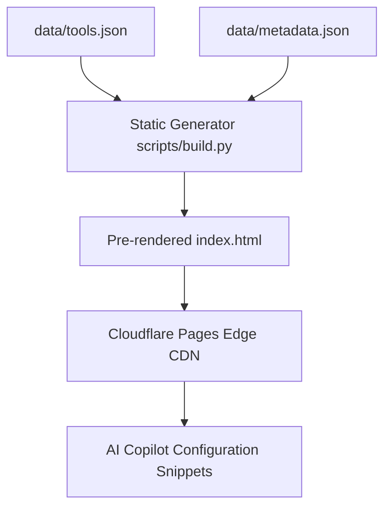

<p align="center">
  <a href="https://tp-link-mcp.dulith.me" target="_blank" rel="noopener noreferrer">
    
  </a>
</p>

<h1 align="center">TP-Link Router MCP Server Web Showcase</h1>

<p align="center">
  Documentation portal and interactive tool explorer for the TP-Link router Model Context Protocol (MCP) server, deployed on Cloudflare Pages.
</p>

<p align="center">
  <a href="https://pages.cloudflare.com/"></a>
  <a href="https://tp-link-mcp.dulith.me"></a>
  <a href="https://modelcontextprotocol.io/"></a>
  <a href="LICENSE"></a>
</p>

<p align="center">
  <a href="#overview">Overview</a> &bull;
  <a href="#architecture--modes">Architecture</a> &bull;
  <a href="#project-structure">Structure</a> &bull;
  <a href="#installation">Installation</a> &bull;
  <a href="#usage">Usage</a> &bull;
  <a href="#session-logging--inspection">Logging</a> &bull;
  <a href="#verification-tests">Testing</a> &bull;
  <a href="#security--privacy">Security</a> &bull;
  <a href="#license">License</a>
</p>

---

## Overview

TP-Link Router MCP Server Web Showcase is the official documentation portal and schema catalog for the `tplink-mcp` server. Featuring a Mintlify-styled design system, the site offers an interactive tool explorer, live search, schema inspection modals, and 1-click configuration generators for AI agent platforms including Claude Desktop, Google Antigravity, Cursor, and Docker.

Developed to support cellular routing optimization experiments on Hutch 4G LTE connections in Malabe, Sri Lanka, the portal serves as a reference implementation for constructing agent-safe, typed MCP server registries for hardware devices.

The portal uses a schema-first architecture: complete tool signatures, descriptions, safety guard levels, and input parameter schemas are maintained in structured JSON and compiled into pre-rendered static HTML prior to deployment on Cloudflare Pages.

- **Primary URL**: [https://tp-link-mcp.dulith.me](https://tp-link-mcp.dulith.me)
- **Fallback URL**: [https://tp-link-mcp.pages.dev](https://tp-link-mcp.pages.dev)

---

## Architecture & Modes

The web showcase documents and provides configuration profiles for four primary AI agent deployment targets.

| Deployment Target | Integration Protocol | Configuration Format | Supported Tool Count | Operational Safety Gate |
| :--- | :--- | :--- | :--- | :--- |
| **Claude Desktop** | Stdio (npx runner) | `claude_desktop_config.json` | 39 tools | `confirm=True` on mutation |
| **Google Antigravity** | Stdio (Python process) | JSON-RPC stdio settings | 39 tools | SafeSession isolation |
| **Cursor IDE** | Stdio (Python process) | `.cursor/mcp.json` | 39 tools | Single-admin lease lock |
| **Docker Container** | Host Network Container | `docker run --network host` | 39 tools | Full runtime sandboxing |



---

## Project Structure

```
.
├── data/
│   ├── metadata.json           # Version, author, stats, and navigation links
│   └── tools.json              # 39 tool specifications, parameters, and risk profiles
├── js/
│   └── app.js                  # Client-side search, filtering, and modal interaction
├── scripts/
│   └── build.py                # Schema validation and pre-rendering engine
├── index.html                  # Documentation template and interactive catalog
└── README.md
```

---

## Installation

### Prerequisites
- Python 3.10 or higher (for schema validation and pre-rendering)

### Setup Steps
1. Clone the repository:
   ```bash
   git clone https://github.com/dulithdivisekara/tp-link-mcp-web.git
   cd tp-link-mcp-web
   ```
2. Validate schemas and inject pre-rendered tool markup:
   ```bash
   python3 scripts/build.py
   ```
3. Start a local preview server:
   ```bash
   python3 -m http.server 8080
   ```
4. Open `http://localhost:8080` in your browser.

---

## Usage

### Updating Tool Signatures
To document new MCP tools or amend schema parameters, modify `data/tools.json` and rebuild:

```bash
python3 scripts/build.py
```

### Production Deployment
Deploy updates directly to Cloudflare Pages:

```bash
npx wrangler pages deploy . --project-name tp-link-mcp --branch main
```

---

## Session Logging & Inspection

The build process provides immediate feedback on schema conformance:

- **Build Output**: Reports validated tool counts and injection confirmations
- **Deployment Audits**: Available via Wrangler CLI or Cloudflare dashboard:
  ```bash
  npx wrangler pages deployment list --project-name tp-link-mcp
  ```

---

## Verification Tests

Run the schema validation engine to verify tool parameter types and metadata:

```bash
python3 scripts/build.py
```

```text
Validating metadata.json...
Validating tools.json...
Successfully validated 39 tools and metadata v1.0.0.
Pre-rendering tools into index.html...
[✓] Successfully injected 39 pre-rendered tools into index.html
```

---

## Security & Privacy

- **Static Distribution**: Delivered as pure static files with no tracking scripts, third-party cookies, or analytics beacons.
- **Credential Safety**: Documentation samples enforce placeholder tokens (`your_router_password`) and explain environment variable isolation.
- **Repository Cleanliness**: `.gitignore` ensures local cache files and deployment tokens remain untracked.

---

## License

This project is licensed under the [MIT License](LICENSE).
Author: [Dulith Divisekara](https://github.com/dulithdivisekara).
